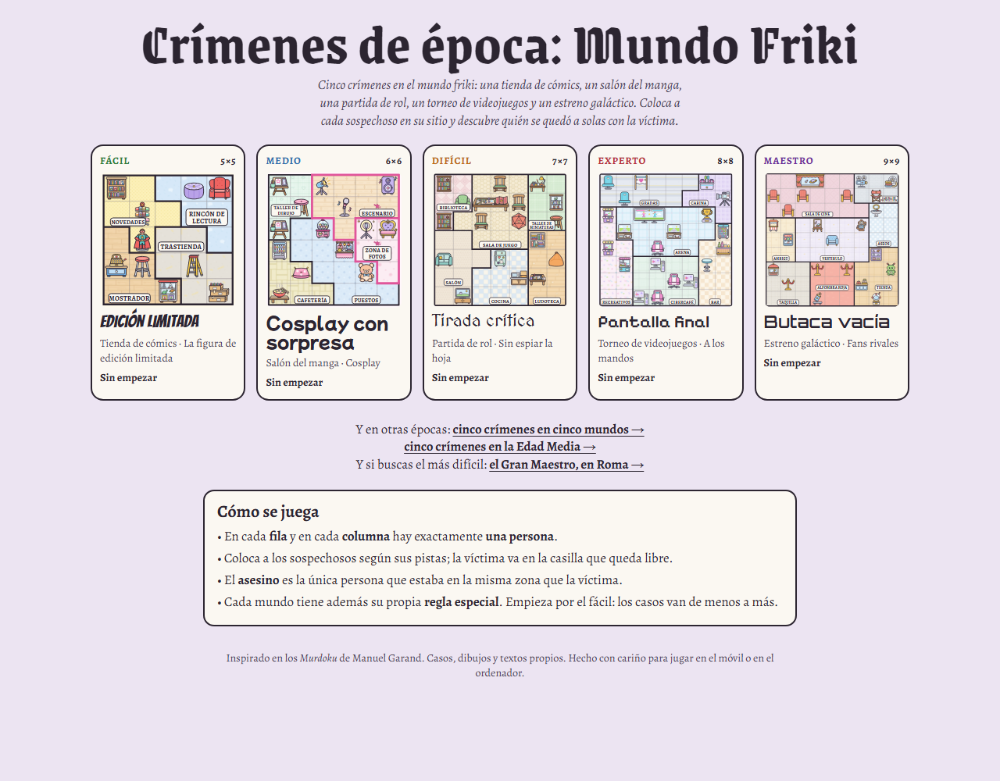

# Crímenes de época: Mundo Friki

Cinco crímenes en el mundo friki: una tienda de cómics, un salón del manga, una partida de rol, un torneo de videojuegos y un
estreno galáctico. Un sudoku de asesinatos: coloca a cada sospechoso en su sitio, uno por fila y por columna, y descubre quién
se quedó a solas con la víctima. Cada mundo tiene su propia regla especial, y los casos van del fácil al maestro. Juego web
autónomo en un único `index.html`.

**Jugar:** https://spyder-cripto.github.io/crimenes-de-epoca-mundo-friki/ · En otras épocas:
[cinco crímenes en cinco mundos](https://spyder-cripto.github.io/crimenes-de-epoca/) ·
[cinco crímenes en la Edad Media](https://spyder-cripto.github.io/crimenes-de-epoca-edad-media/) · El más difícil:
[el Gran Maestro, en Roma](https://spyder-cripto.github.io/crimenes-de-epoca-gran-maestro/).

## Cómo se juega
- En cada **fila** y en cada **columna** hay exactamente **una persona**.
- Coloca a los sospechosos según sus pistas; la víctima va en la casilla que queda libre.
- El **asesino** es la única persona que estaba en la misma zona que la víctima.
- **Ninguna zona se quedó vacía.**
- No se puede estar en una casilla con un objeto, salvo los que se ocupan (sillas, butacas, sillas gamer…).
- «Al lado de» es arriba, abajo, a la izquierda o a la derecha; «al este de», en cualquier columna a su derecha (no hace falta que sea la de al lado); «al norte de», en cualquier fila más arriba.
- **Colocar**, **notas** (las iniciales de quien podría estar en cada casilla) y **tachar**; deshacer, comprobar y pistas
  opcionales, que enseñan el siguiente paso de la deducción.

## Los casos
| Nivel | Caso | Mundo | Regla especial |
|---|---|---|---|
| Fácil · 5×5 | Edición limitada | Tienda de cómics | La figura de edición limitada: nadie puede estar pegado a la figura de superhéroe |
| Medio · 6×6 | Cosplay con sorpresa | Salón del manga | Cosplay: los cosplayers solo en el Escenario y la Zona de fotos, el público nunca, la organización donde quiera |
| Difícil · 7×7 | Tirada crítica | Partida de rol | Sin espiar la hoja: dos jugadores nunca están en diagonal |
| Experto · 8×8 | Pantalla final | Torneo de videojuegos | A los mandos: cada jugador está al lado de una consola o de un ordenador |
| Maestro · 9×9 | Butaca vacía | Estreno galáctico | Fans rivales: un fan nunca está en la misma sala ni en diagonal a un fan de la saga rival |

Cada caso tiene una sola solución, comprobada por ordenador por dos caminos independientes. En todos hacen falta la regla
especial y «ninguna zona vacía», y no sobra ninguna pista.

## Créditos
- Casos, reglas especiales, arte y textos: **Spider** (Fali + Claude), 2026.
- Inspirado en los *Murdoku* de Manuel Garand.
